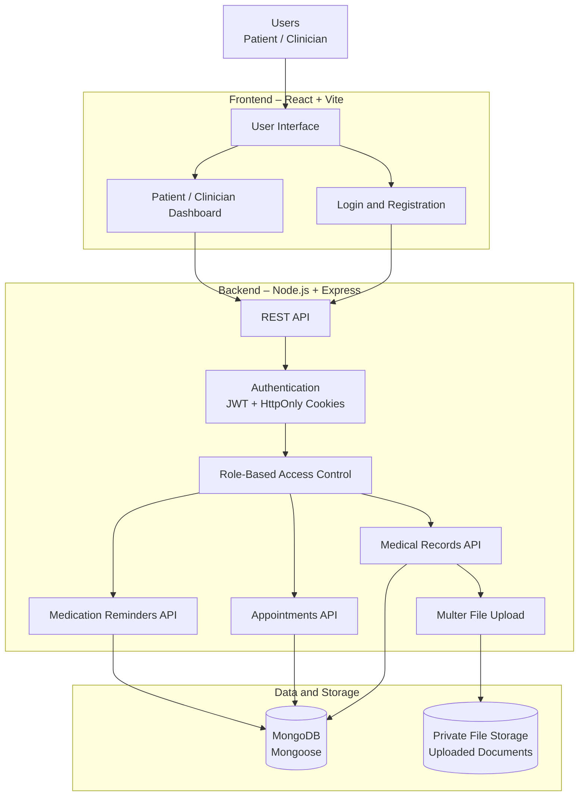

# HealthVault – System Architecture

HealthVault is a full-stack healthcare management application built with React, Node.js, Express, and MongoDB.

## Architecture Diagram

## Technology Stack

- Frontend: React, Vite, CSS
- Backend: Node.js, Express.js
- Database: MongoDB, Mongoose
- Authentication: JWT and HttpOnly cookies
- Password Security: bcryptjs
- File Upload: Multer
- Version Control: Git and GitHub

## Main Modules

1. Patient and clinician authentication
2. Medical record management
3. Appointment management
4. Medication reminders
5. Patient-controlled record sharing and consent
